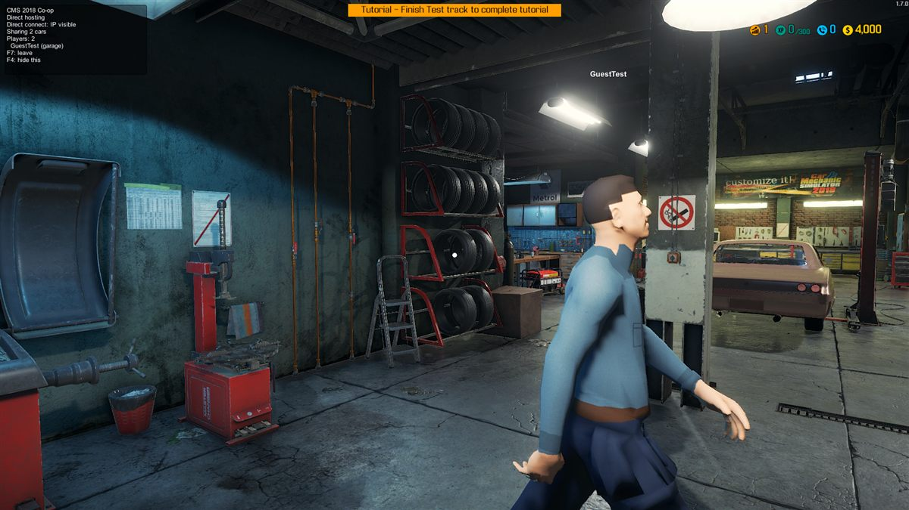

# CMS 2018 Co-op

A multiplayer mod for Car Mechanic Simulator 2018. Up to 4 people work in the same garage over Steam.



## What works

- Invite friends through Steam (F6). They join your lobby straight from the invite.
- Other players show up as an animated mechanic with idle, walk and run animations and a name tag.
- Shared garage: the host's cars are copied to everyone when they load in.
- Parts coming off and going on, part condition, doors, hood and trunk stay in sync.
- Car lifts go up and down for everyone at the same time.
- Moving a car between spots (lifts, paint booth, dyno), paint, liveries and oil stay in sync.
- Hold Shift to sprint (1.2x speed, no stamina).
- A guest's own save is backed up when they join and restored the next time they start the game.

Still rough: only the host can take jobs, money and inventory are per player, and things like the paint shop and tire changer are not synced yet (those work on your own inventory, so each player uses their own).

## Install

1. Download the zip from [Releases](../../releases).
2. Extract it anywhere and double-click `INSTALL.bat`. It finds the game through Steam (any library drive) and copies the mod in. If it can't find the game it asks for the folder.
3. Start the game. A "CMS 2018 Co-op" box in the top-left corner means it loaded.

`UNINSTALL.bat` removes it again. Everyone needs the same version.

| Key | Action |
| --- | --- |
| F6 | Host / invite |
| F7 | Leave |
| F4 | Hide the status box |
| Left Shift | Sprint |

Keys, sprint speed and other settings are in `BepInEx/config/fishybeing.cms2018coop.cfg`.

## How it works

- Loads through [BepInEx 5](https://github.com/BepInEx/BepInEx) and hooks the game with Harmony.
- Networking uses the Steamworks.NET copy that ships with the game: a friends-only lobby plus Steam P2P packets. There is also a direct UDP mode (`-coop-host <port>` / `-coop-join <ip:port>`) for LAN and testing.
- The host's garage is the source of truth. When a guest arrives, the host saves each car with the game's own car save code and streams the file over. After that both sides compare part states four times a second and send only what changed.
- The mechanic is a Mixamo-rigged model. `tools/build_model.py` runs in Blender, retargets the Idle, Walk and Run clips onto it, paints a texture and writes everything into one file the mod reads at runtime, since the game has no way to import models on its own.

## Building

Needs the .NET SDK and the game installed (the project references the game's DLLs).

```
cd src
dotnet build -c Release
```

Copy `src/bin/Release/CMS2018Coop.dll` and `mechanic.cmsm` into `BepInEx/plugins`.

Not affiliated with Red Dot Games.
